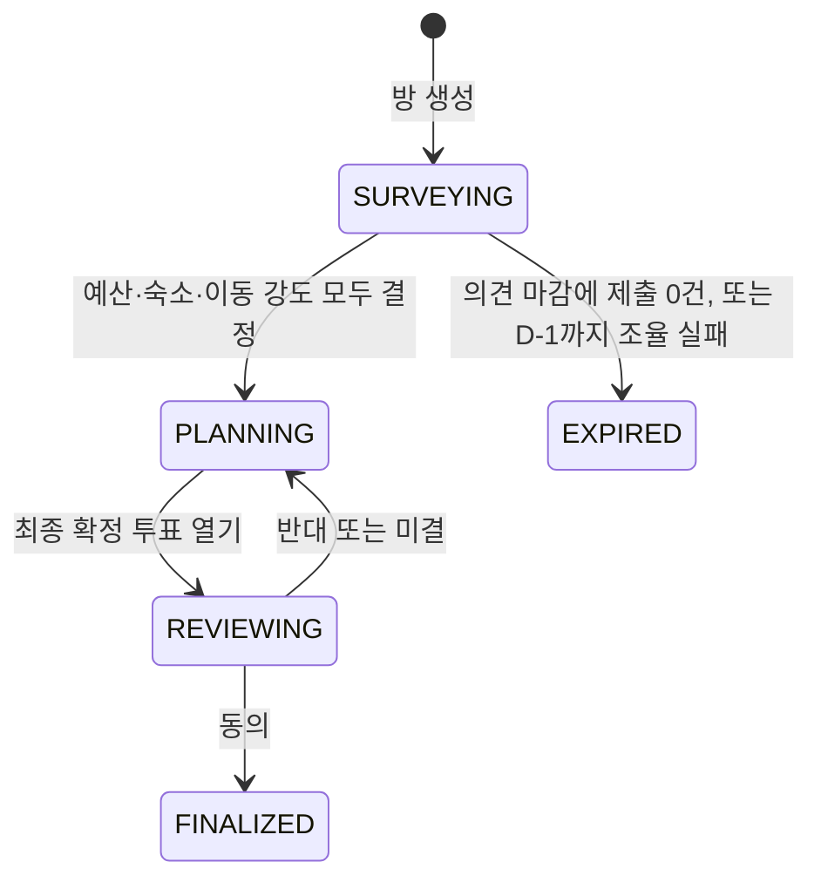

# room — 여행방

여행방을 만들고, 초대 코드로 들어오고, 나가는 일을 맡는다. 방의 진행 단계(`RoomStatus`)를 들고 있는 곳이기도 해서, 다른 모든 도메인이 "지금 이 방에서 이 일을 해도 되는가"를 이 패키지에 묻는다.

## API

| 메서드 | 경로 | 하는 일 |
| --- | --- | --- |
| POST | `/api/rooms` | 여행방 생성 |
| GET | `/api/rooms` | 내 여행방 목록 |
| GET | `/api/rooms/{roomId}` | 여행방 상세 (남아 있는 멤버와 설문 제출 여부) |
| GET | `/api/rooms/{roomId}/summary` | 마지막으로 본 뒤 생긴 일 요약 |
| POST | `/api/rooms/{roomId}/seen` | 어디까지 봤는지 기록 |
| DELETE | `/api/rooms/{roomId}/members/me` | 여행방 나가기 |
| GET | `/api/rooms/invites/{inviteCode}` | 초대 미리보기 (로그인 없이 가능) |
| POST | `/api/rooms/invites/{inviteCode}/join` | 초대 코드로 참여 |

## 주요 클래스

| 클래스 | 하는 일 |
| --- | --- |
| [`Room`](entity/Room.java) | 방 정보와 상태 전이. 상태를 바꾸는 메서드는 모두 여기 있다 |
| [`RoomMember`](entity/RoomMember.java) | 방 참여 기록. 나가면 행을 지우지 않고 `leftAt`을 남긴다 |
| [`RoomService`](service/RoomService.java) | 생성, 참여, 조회, 그리고 방 잠금(`getForUpdate`) |
| [`RoomMemberService`](service/RoomMemberService.java) | 활동 멤버 확인(`getActiveMember`)과 인원 세기 |
| [`RoomLeaveService`](service/RoomLeaveService.java) | 나가기. 설문·안건·장소에 남은 흔적을 정리한다 |
| [`RoomSummaryService`](service/RoomSummaryService.java) | 비접속 요약. 일의 종류마다 최대 5줄로 묶는다 |
| [`RoomCleanupScheduler`](service/RoomCleanupScheduler.java), [`RoomCleanupService`](service/RoomCleanupService.java) | 매일 새벽 3시, 오래된 방을 방마다 별도 트랜잭션으로 지운다 |

## 방의 진행 단계

`FINALIZED`와 `EXPIRED`는 읽기 전용이다. 상태를 바꾸는 메서드(`startPlanning`, `startReview`, `finalizePlan`, `returnToPlanning`, `expire`)는 바꾸기 전 상태를 스스로 확인한다. 호출하는 쪽이 방 잠금 안에서 상태를 이미 확인한 뒤에만 부르기 때문에, 여기서 상태가 어긋나면 그건 사용자 실수가 아니라 코드 버그다.

## 알아 둘 규칙과 설계

### 같은 방의 쓰기는 방 잠금으로 줄을 세운다

방의 상태를 바꿀 수 있는 쓰기 API는 트랜잭션의 첫 쿼리로 방 행에 비관적 락을 건다. 보통은 `RoomService.getForUpdate(roomId)`를 부르고, 참여와 나가기는 저장소의 `findByInviteCodeForUpdate`·`findByIdForUpdate`를 직접 부른다. 상태를 바꾸지 않는 코멘트 작성과 확인 시각 갱신은 잠그지 않는다. 마지막 두 표가 동시에 들어오거나, 투표와 퇴장이 겹쳐도 판정은 한 번만 일어난다. 이 메서드는 `Propagation.MANDATORY`다. 잠금은 트랜잭션이 끝날 때 풀리므로, 트랜잭션 밖에서 부르면 잡자마자 풀려 아무것도 막지 못한다. 그래서 트랜잭션 없이 부르면 바로 예외가 나게 해 두었다.

### 방 생성은 초대 코드 충돌을 재시도로 푼다

초대 코드는 UUID 앞 8자리다. 겹치면 DB 유니크 제약(`uk_plan_room_invite_code`)에 걸리는데, 그때는 새 코드로 최대 10번까지 다시 시도한다. 방을 만들면 의견 마감 시각(생성 + 3일)이 정해지고, 여행 일수만큼 일정의 날(`ScheduleDay`)도 함께 만들어진다. 출발일은 24시간 뒤부터 1년 안이어야 하고, 여행은 최대 31일이다.

### 나가기는 순서가 중요하다

`RoomLeaveService.leave`는 아래 순서로 처리한다.

1. 설문 응답을 지운다.
2. 멤버에 `leftAt`을 남긴다.
3. 나간 멤버의 SSE 연결을 끊는 이벤트를 발행한다.
4. 퇴장 기록을 남긴다.
5. 설문이 마감되는지 판정한다.
6. 진행 중인 안건을 다시 판정한다.
7. 설문이 마감됐다면 1회차 안건을 연다.
8. 장소 반응을 지운다.

커밋 뒤 이벤트는 발행한 순서대로 처리되므로, 3번을 먼저 해야 이 퇴장 때문에 생긴 소식이 방금 나간 사람에게 가지 않는다. 6번이 7번보다 앞서야 하는 이유도 있다. 순서가 바뀌면 방금 연 안건에서 나간 멤버를 투표 자격자로 보고, 자격자 수를 한 번 더 줄인다. 한 번 나간 사람은 같은 방에 다시 들어올 수 없다(`REJOIN_NOT_ALLOWED`).

### 정리 대상은 `EXPIRED` 상태와 무관하다

매일 지우는 방은 두 종류다. 의견 마감이 7일 넘게 지났는데 설문이 한 건도 없는 방, 그리고 여행이 끝난 지 14일이 넘은 방이다. `agenda_item`과 `agenda_option`은 서로를 외래 키로 가리키기 때문에, 지우기 전에 `resolved_option_id`를 먼저 비워 순환을 끊는다.

## 다른 패키지와의 관계

room은 기반 패키지라 survey, agenda, place, schedule이 모두 room을 부른다. 반대로 room이 다른 도메인의 정보를 알아야 할 때도 있다. 비접속 요약에는 "아직 투표 안 한 안건"과 "아직 남아 있는 장소"가 필요하다. 이때 room이 agenda나 place를 직접 부르면 의존이 순환한다. 그래서 room에 인터페이스([`UnvotedAgendaProvider`](service/UnvotedAgendaProvider.java), [`ActivePlaceFilterProvider`](service/ActivePlaceFilterProvider.java))만 두고, 구현은 agenda의 `UnvotedAgendaFinder`와 place의 `ActivePlaceFilter`가 맡는다. 나가기는 survey, agenda, place, changelog를 차례로 부르는 조율 지점이다.
